# Devanshu Singh

> **Computer Science Engineering (UG '26) • Specializing in Cyber Security & Software Engineering**  
> *Institute of Technical Education and Research (ITER), SOA University • Bhubaneswar, India*

 

&nbsp;

&nbsp;

&nbsp;

  

<!-- TELEMETRY HERO HUD -->

  

<h3><code>// TELEMETRY: ANNUAL COMMIT CADENCE</code></h3>

<!-- LIVE 53-WEEK CONTRIBUTION MATRIX -->

  

<h3><code>// SYSTEM ARCHITECTURE & FEATURED REPOSITORIES</code></h3>

<!-- FEATURED PROJECT ARCHITECTURE MATRIX -->

 

### 📂 Repository Directory & Direct Access

| Project | Domain / Architecture | Tech Stack | Status | Link |
| :--- | :--- | :--- | :--- | :--- |
| **[LockItPDF](https://github.com/devcodes2108/LockItPDF)** | Full-Stack Dockerized PDF Security & Password Shielding Engine | `Python` `Docker` `JS` `HTML/CSS` | `Production` | [View Repo →](https://github.com/devcodes2108/LockItPDF) |
| **[SecurePDF-BatchEncryptor](https://github.com/devcodes2108/SecurePDF-BatchEncryptor)** | Automated High-Throughput Batch Cryptographic Pipeline | `Python` `Jupyter` `Cryptography` | `Active` | [View Repo →](https://github.com/devcodes2108/SecurePDF-BatchEncryptor) |
| **[devanshu-portfolio](https://github.com/devcodes2108/devanshu-portfolio)** | Production Developer Portfolio & Technical Showcase | `TypeScript` `React` `TailwindCSS` | `Deployed` | [View Repo →](https://github.com/devcodes2108/devanshu-portfolio) |
| **[quick-push](https://github.com/devcodes2108/quick-push)** | High-Velocity Developer Git Workflow Accelerator | `TypeScript` `Git CLI` `Automation` | `Tooling` | [View Repo →](https://github.com/devcodes2108/quick-push) |
| **[Python-OOPS Series](https://github.com/devcodes2108/Python-OOPS)** | OOP Design Patterns, Data Structures & Advanced Built-ins | `Python` `Jupyter Notebook` | `Knowledge Base` | [View Repo →](https://github.com/devcodes2108/Python-OOPS) |

 

<h3><code>// PRODUCTION TECH STACK & CAPABILITIES</code></h3>

<table>
  <tr>
    <td width="25%" valign="top">
      <strong>🛡️ Cyber Security</strong>
      <ul>
        <li>Cryptography (AES/RSA)</li>
        <li>Access Control & RBAC</li>
        <li>Container Security (Docker)</li>
        <li>Network & Threat Analysis</li>
      </ul>
    </td>
    <td width="25%" valign="top">
      <strong>⚡ Languages</strong>
      <ul>
        <li>TypeScript / JavaScript</li>
        <li>Python 3 (OOP & Scripting)</li>
        <li>HTML5 / Modern CSS</li>
        <li>PowerShell / Bash</li>
      </ul>
    </td>
    <td width="25%" valign="top">
      <strong>🌐 Web & Systems</strong>
      <ul>
        <li>React / Next.js</li>
        <li>REST API Design</li>
        <li>Tailwind CSS</li>
        <li>Microservices Architecture</li>
      </ul>
    </td>
    <td width="25%" valign="top">
      <strong>🛠️ DevOps & Tooling</strong>
      <ul>
        <li>Git & GitHub Actions CI/CD</li>
        <li>Docker Containerization</li>
        <li>Jupyter Data Workflows</li>
        <li>Linux Environments</li>
      </ul>
    </td>
  </tr>
</table>

 

<h3><code>// ABOUT ME</code></h3>

I'm a pre-final year Computer Science Engineering student passionate about building secure systems and robust digital products. 
Alongside engineering, I am an active <strong>public speaker</strong>, <strong>content writer</strong>, and <strong>technical communicator</strong>. 
Always open to collaborating on Cyber Security tooling, full-stack open-source projects, and research initiatives.

 

  <code>⚡ Self-hosted SVGs auto-refreshed daily via GitHub Actions • Built with pure Python • Zero 3rd-party tracking</code>

