<div align="center">

<h3><code>devcodes2108@github ~ $ ./contributions.sh</code></h3>



<br><br>

<h3><code>devcodes2108@github ~ $ whoami</code></h3>

<table>
  <tr>
    <td valign="top"></td>
    <td valign="top"></td>
  </tr>
</table>

<br>

<code>built with Python · SVG · GitHub Actions</code>

</div>

## Customize locally

```bash
python -m venv .venv
source .venv/bin/activate
pip install -r scripts/requirements.txt
python scripts/prep_photo.py source-photo.jpg
python scripts/make_ascii_svg.py
python scripts/make_info_card.py
python scripts/fetch_contributions.py
python scripts/render_heatmap_svg.py
```

The portrait pipeline is intentionally local: add a face-forward `source-photo.jpg`, generate `source-prepped.png`, and commit only the resulting SVG. The contribution graph uses GitHub's public calendar HTML, so no token or third-party stats service is required.
