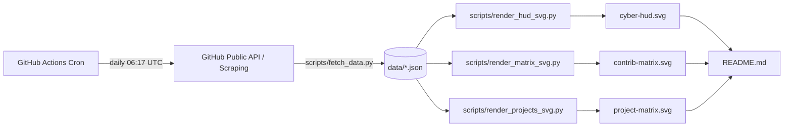

# Customization & Architecture Guide

This repository powers **Devanshu Singh's (@devcodes2108)** live animated GitHub profile. It uses self-contained, light/dark-adaptive animated SVGs that are auto-generated from real GitHub data and scheduled via GitHub Actions.

---

## 🏗️ Architecture Overview



All generation scripts run with **Python 3 standard libraries only** (zero third-party dependencies required).

---

## 🚀 Running Locally

1. **Clone your repository**:
   ```bash
   git clone https://github.com/devcodes2108/devcodes2108.git
   cd devcodes2108
   ```

2. **Run the entire pipeline in one command**:
   ```bash
   python scripts/build_all.py
   ```

3. **Preview the generated visuals**:
   Double click or open any of the following files in your web browser:
   * `cyber-hud.svg`
   * `contrib-matrix.svg`
   * `project-matrix.svg`
   * `README.md`

---

## 🎨 How to Customize

### 1. Changing the Featured Projects
Open `scripts/render_projects_svg.py` and update the `FEATURED` list:
```python
FEATURED = [
    {
        "name": "LockItPDF",
        "tag": "CRYPTOGRAPHY // SEC-OPS",
        "desc": "Full-stack Dockerized PDF encryption engine with granular access control.",
        "stack": ["Python", "Docker", "JS/CSS", "Security"],
        "status": "CONTAINERIZED",
        "icon_color": "#00f2fe",
        "icon_type": "shield", # 'shield', 'lock', 'globe', or 'terminal'
        "url": "https://github.com/devcodes2108/LockItPDF"
    },
    # Add or modify other cards here...
]
```
After editing, re-run `python scripts/render_projects_svg.py`. Remember to also update the links in the markdown table in `README.md`.

### 2. Customizing Color Themes & Glow Accents
Each SVG uses standard CSS Custom Properties (`:root` for Dark mode, `@media (prefers-color-scheme: light)` for Light mode).

* **Cyber Telemetry HUD**: Edit `:root` in `scripts/render_hud_svg.py`:
  * `--accent-cyan`: `#00f2fe` (Electric Cyan)
  * `--accent-green`: `#10b981` (Emerald Security)
  * `--accent-amber`: `#f59e0b` (Alert Amber)
* **Heatmap Matrix Ramp**: Edit `--lvl-0` through `--lvl-4` in `scripts/render_matrix_svg.py`.
* **Projects Matrix**: Edit card border and badge variables in `scripts/render_projects_svg.py`.

### 3. Updating Profile Taglines & Identity
* Profile identity is automatically fetched from GitHub, but can be styled or extended directly inside `scripts/render_hud_svg.py` (e.g. changing the specialization badge or university label).
* The social buttons and about section can be edited directly in `README.md`.

---

## ⚙️ GitHub Actions Automation

The automated workflow lives in [`.github/workflows/update-profile.yml`](../.github/workflows/update-profile.yml).

* **Trigger**:
  * Runs automatically every day at `06:17 UTC` via cron schedule.
  * Can be triggered manually at any time via the **Actions** tab on GitHub (`Run workflow`).
  * Triggers on changes to `scripts/**` pushed to `main`.
* **Security & Bot Protection**:
  * Uses GitHub's built-in `GITHUB_TOKEN` with `permissions: contents: write`.
  * Commits changes using `[skip ci]` to prevent infinite recursive build loops.

